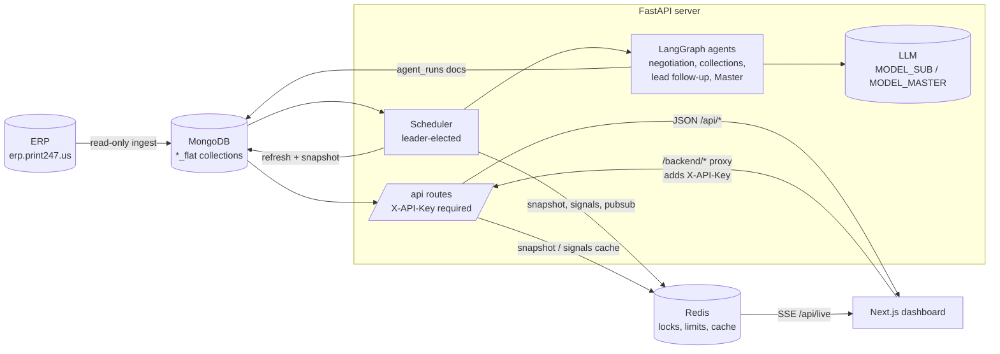

# Biztek AI Command Center

A live operations dashboard for a printing business, wired to the ERP: money in,
money out, stuck quotes, stuck leads - plus four AI agents that read those
numbers and draft the next human conversation. The LLM never does arithmetic and
nothing is ever sent to a customer: every amount, ID and contact detail in the
UI comes from Python, and every draft is stored text for a person to review.

Two applications live in this repository:

| Directory | What it is |
| --- | --- |
| `server/` | FastAPI + MongoDB + Redis + LangGraph agents (Python 3.14) |
| `client/` | Next.js 16 dashboard (React 19, Tailwind 4, ECharts) |

## Architecture



* `server/app/services/processors.py` - all business rules and arithmetic, pure Python.
* `server/app/agents/graph.py` - one pipeline run: load signals -> three sub-agents
  (max `MAX_ITEMS_PER_AGENT` each) -> group by customer -> Master brief -> save to `agent_runs`.
  Guardrails around every draft: only the item's own money fields may be mentioned,
  copied fields are rewritten by code, glued-together words get one regeneration and a
  code fix, bad drafts become `needs_review` instead of shipping.
* `server/app/agents/chat.py` - the read-only chat agent; its validator only accepts
  numbers, IDs and dates that this turn's tool results actually returned.
* Nothing writes to the ERP, and `/api/voice`, `/api/approve` and a fulfillment agent
  are deliberately not built.

## Prerequisites

* Python 3.14 (`server/.venv`) and Node.js 20+ (developed on 24)
* MongoDB on `mongodb://localhost:27017`, database `AI`
* Redis on `redis://localhost:6379` - locks, limits and the dashboard caches
* ERP refresh token (read-only) for ingestion, and an LLM key for the agents/chat

## Setup

### 1. Backend

```sh
cd server
python3 -m venv .venv
.venv/bin/python -m pip install -r requirements.txt
cp .env.example .env        # then fill in ERP_REFRESH_TOKEN, LLM_API_KEY, API_KEYS
.venv/bin/python -m uvicorn app.main:app --reload --port 8000
```

`GET /health` answers without a key; every other `/api` route needs the
`X-API-Key` header set to one of the `API_KEYS` values. Mongo indexes are
created on startup, so a fresh database is ready immediately.

### 2. Load ERP data

```sh
.venv/bin/python -m scripts.ingest_erp          # full backfill from INGEST_FROM
.venv/bin/python -m scripts.inspect_data        # what is in the database
.venv/bin/python -m scripts.flatten             # rebuild the *_flat collections
```

The ERP client is strictly read-only; only derived `*_flat` rows are written.

### 3. Frontend

```sh
cd client
npm install
cp .env.example .env.local   # BACKEND_API_URL + BACKEND_API_KEY
npm run dev                  # http://localhost:3000
```

The browser never sees the API key: the dashboard calls same-origin
`/backend/...`, and the Next.js route handler in
`client/app/backend/[...path]/route.ts` adds `X-API-Key` on the server and
streams the answer back (including the `/api/live` SSE stream). Set
`BACKEND_API_KEY` to one of the backend's `API_KEYS`. `NEXT_PUBLIC_API_BASE_URL`
bypasses the proxy and is only useful while the backend runs with
`AUTH_ENABLED=false`.

## Running the agents

```sh
cd server
.venv/bin/python -m scripts.run_agents          # reuses the 24h input-hash cache
.venv/bin/python -m scripts.run_agents --fresh  # calls the LLM for every item
```

The same pipeline runs from the API (`POST /api/agents/run`, one run at a time -
a second concurrent call gets `409` with the run already in progress) and from
the scheduler, which only runs agents when item hashes changed since the last run.
Results land in the `agent_runs` collection and are rendered in the **AI review**
tab. Output that fails a validator is stored with `needs_review` and no draft.

## Tests

```sh
# backend: 135 tests, all against fakes - no Mongo, no Redis, no LLM calls
cd server && .venv/bin/python -m pytest -q

# client: lint, Vitest + React Testing Library, production build
cd client && npm run lint && npm test && npm run build
```

CI (`.github/workflows/ci.yml`) runs both jobs on every push and pull request.

## Configuration

`server/.env` (see `server/.env.example` for commented copies of all of these)
and `client/.env.local` for the proxy.

### Backend

| Variable | Default | What it does |
| --- | --- | --- |
| `MONGO_URI` | `mongodb://localhost:27017` | Mongo connection string |
| `MONGO_DB` | `AI` | database name |
| `ERP_BASE_URL` | `https://erp.print247.us` | ERP origin (read-only client) |
| `ERP_REFRESH_TOKEN` | empty | ERP token; never logged or committed |
| `INGEST_FROM` | 12 months ago | how far back ingestion goes (`YYYY-MM-DD`) |
| `ERP_REQUEST_DELAY_SECONDS` | `0.3` | polite delay between ERP pages |
| `ERP_PAGE_LIMIT` | `500` | page size for ERP lists |
| `ERP_LEAD_BATCH_SIZE` | `25` | leads per lead-outcomes call |
| `REDIS_URL` | `redis://localhost:6379` | locks, limits, caches, pub/sub |
| `AUTH_ENABLED` | `true` | `false` disables the API key (local dev only; logged loudly) |
| `API_KEYS` | empty | comma-separated `X-API-Key` values |
| `CORS_ORIGINS` | `http://localhost:3000` | comma-separated allowed browser origins |
| `STALE_QUOTE_DAYS` | `3` | a quote is stale after this many days |
| `STALE_QUOTE_MAX_AGE_DAYS` | `30` | older open quotes are dead history, skipped |
| `STALLED_ORDER_DAYS` | `2` | stalled-order threshold (signal is unreliable by design) |
| `OVERDUE_INVOICE_DAYS` | `30` | an invoice is overdue after this many days |
| `LEAD_ACTIVE_DAYS` | `14` | activity window for a "stuck" lead |
| `MAX_ITEMS_PER_AGENT` | `10` | items each sub-agent processes per run |
| `AGENT_CACHE_HOURS` | `24` | input-hash cache window for agent output |
| `AGENT_CONCURRENCY` | `5` | parallel LLM calls per sub-agent |
| `AGENT_RUN_LOCK_TTL_SECONDS` | `1800` | TTL of the one-run-at-a-time lock |
| `LLM_PROVIDER` | empty | e.g. `openai` |
| `LLM_API_KEY` | empty | provider key; never logged |
| `MODEL_SUB` | empty | model for the three sub-agents, e.g. `gpt-5-nano` |
| `MODEL_MASTER` | empty | model for the Master brief and chat |
| `SUB_AGENT_REASONING_EFFORT` | `minimal` | cheap is fine for short structured drafts |
| `MASTER_REASONING_EFFORT` | `low` | `minimal` glues words and leaves thinking in the text |
| `CHAT_REASONING_EFFORT` | `low` | same reason for chat answers |
| `CHAT_DAILY_TOKEN_CAP` | `1000000` | daily chat token budget |
| `CHAT_RATE_LIMIT_REQUESTS` | `30` | chat requests per window, shared through Redis |
| `CHAT_RATE_LIMIT_WINDOW_SECONDS` | `60` | sliding window size |
| `LIVE_MAX_CLIENTS` | `20` | concurrent `/api/live` SSE streams |
| `LIVE_CLIENT_SLOT_TTL_SECONDS` | `3600` | an unreleased SSE slot expires after this |
| `SIGNALS_ITEM_LIMIT` | `200` | rows per list in `/api/signals` (counts stay exact) |
| `REFRESH_MINUTES` | `10` | scheduler cycle: refresh, snapshot, signals cache |
| `REFRESH_LOOKBACK_DAYS` | `2` | how many recent days a refresh re-pulls |
| `AGENT_FULL_RUN_HOUR` | `6` | daily full-run safety net (server local time) |
| `SCHEDULER_ENABLED` | `true` | `false` keeps the API up without background jobs |

### Frontend (`client/.env.local`, server-side only)

| Variable | Default | What it does |
| --- | --- | --- |
| `BACKEND_API_URL` | `http://localhost:8000` | where the `/backend` proxy forwards |
| `BACKEND_API_KEY` | empty | `X-API-Key` the proxy sends (one of `API_KEYS`) |
| `NEXT_PUBLIC_API_BASE_URL` | empty (uses the proxy) | direct backend origin for the browser; dev only |

## API

Every `/api` route needs `X-API-Key`; `/health` is open.

| Route | Purpose |
| --- | --- |
| `GET /health` | API + Mongo round-trip, no key |
| `GET /api/metrics` | latest dashboard snapshot |
| `GET /api/live` | SSE: `snapshot`, `briefing`, `error`, heartbeats |
| `GET /api/signals?stale_days=&stalled_days=&overdue_days=&include_stalled=` | attention lists, served from the Redis cache |
| `GET /api/leads/stuck?days=&limit=` | stuck leads, parsed in Python (no contacts exposed) |
| `POST /api/agents/run` | start one pipeline run; `409` + `run_id` when one is running |
| `GET /api/briefing/latest` | newest `agent_runs` document |
| `GET /api/customers/{id}/context?lead_limit=` | one customer joined from Mongo + ERP leads |
| `POST /api/chat` | SSE chat: `tool`, `token`, `reset`, `done`, `error` |

Not built (by design): `/api/voice`, `/api/approve`, a fulfillment agent.

## Repo map

```
server/app/api/        routes, SSE live stream, API key dependency
server/app/agents/     graph pipeline, 3 sub-agents, Master, chat, text rules
server/app/services/   processors (all math), refresh, metrics, scheduler,
                       signals cache, limits, run_guard, indexes, erp_client
server/app/schemas/    Pydantic models for responses and agent output
server/scripts/        ingest_erp, run_agents, flatten, inspect_data
client/app/            page, layout and the /backend proxy route handler
client/components/     dashboard shell + dashboard/* panels, approval inbox, chat
client/hooks/          use-live-data, use-signals, use-stuck-leads
```
